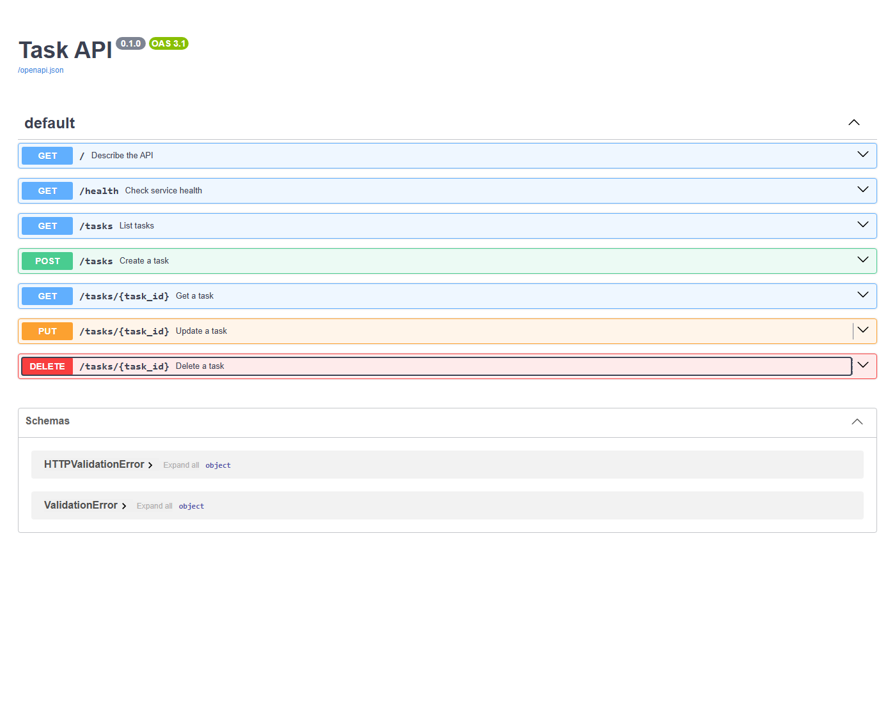

# Task API rebuild

This is an AI-assisted, openly disclosed rebuild of the earlier flyrank-01-crud-api implementation, not a claim of hand-written original work. Stages are implemented and checked in real chronological order with current timestamps.

Install Python 3.12+, then `python -m pip install -r requirements.txt`.
Run: `python -m uvicorn app:app --port 8101`. Open http://localhost:8101/docs.

| Method | Endpoint | Result |
|---|---|---|
| GET | /, /health | 200 API info/health |
| GET | /tasks, /tasks/{id} | 200 list/task; 404 missing |
| POST | /tasks | 201; 400 invalid input |
| PUT | /tasks/{id} | 200; 400 invalid; 404 missing |
| DELETE | /tasks/{id} | 204; 404 missing |

In-memory tasks reset when the server restarts. Titles must be non-empty strings; done must be boolean. PUT accepts partial updates. Test: `python checkpoint.py`.

## Requirement checks
- [x] One documented server command; five CRUD endpoints on memory only.
- [x] 200/201/204/400/404 checked at Stage 4, JSON errors.
- [x] POST and PUT validate titles.
- [x] OpenAPI lists all routes.
- [x] Actual curl and browser Try-it-out full CRUD verified; see verification.txt and new screenshot below.
- [x] Public repository and seven real stage commits; AI-assisted provenance disclosed.

This is an AI-assisted rebuild as authorized by the user; it must not be represented as hand-built.



Example real curl output is recorded in [verification.txt](verification.txt), including HTTP 201 create, 200 update and 204 delete.

Actual curl response (full transcript in verification.txt):

```http
HTTP/1.1 201 Created
date: Thu, 05 Nov 2026 07:38:07 GMT
server: uvicorn
content-length: 47
content-type: application/json
```
